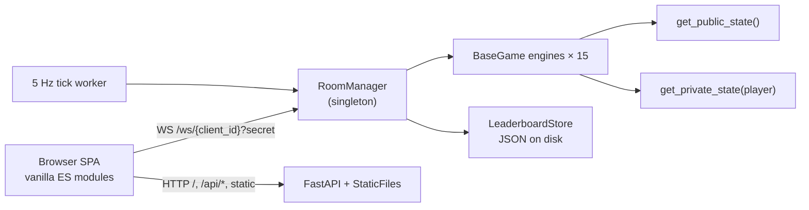
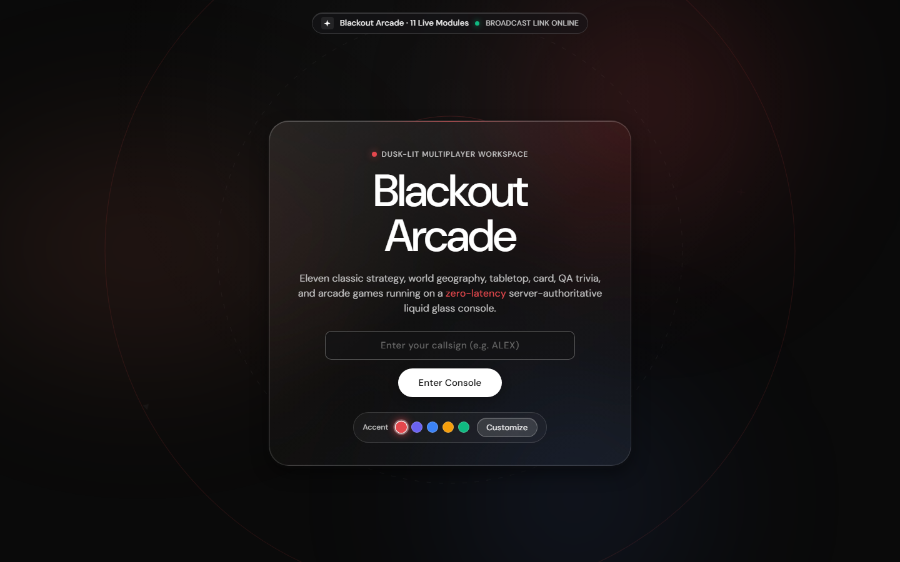
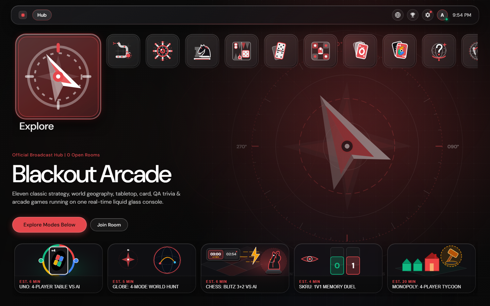
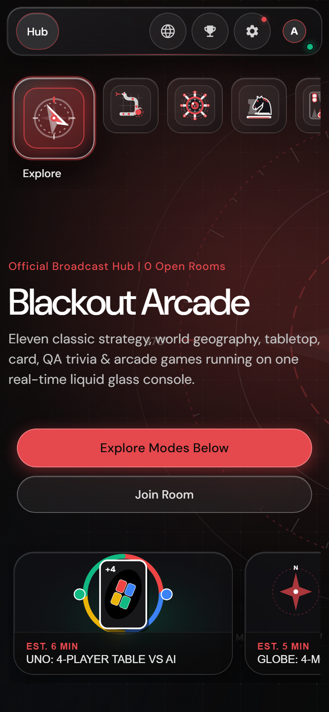

# Blackout Arcade — Website Analysis

**Analyzed:** 14 November 2026  
**Scope:** `D:\LEARNING\cs50\games website` — `main` branch, including the uncommitted M1–M5 “4 new games” expansion  
**Method:** static review (~46k lines), full pytest run, live HTTP/WebSocket probes, headless-Chrome rendering, adversarial engine fuzzing, asset and header measurement  
**Artifacts:** 9 browser screenshots in [`screenshots/`](screenshots), capture scripts in this folder

---

## 1. Executive summary

**Blackout Arcade is a genuinely impressive hobby-scale product:** 15 server-authoritative games, a distinctive “Liquid Glass console” UI, 1,800 curated quiz questions, 197 country dossiers, a clean `BaseGame` contract, disciplined HTML escaping, and 363 automated tests.

It is **not production-ready**. The four-game expansion is only partly finished, one rules bug breaks Connect 4 for every player, sessions can be hijacked after a disconnect, abandoned rooms and client sessions leak, and the test suite is currently red.

| Dimension | Score | Rationale |
|---|---:|---|
| Visual / product design | **9 / 10** | Coherent, distinctive, responsive; strongly executed |
| Backend architecture | **7.5 / 10** | Clean game contract and room lifecycle; single-process, in-memory, god-object `RoomManager` |
| Game correctness | **6.5 / 10** | 354 green tests, but a critical timer bug and two half-integrated games |
| Security | **5.5 / 10** | Excellent XSS/input discipline, weak session and rate-limit model |
| Performance | **6 / 10** | 588 KB uncompressed shell, no gzip/cache headers, eager 193 KB payload |
| Testing | **7 / 10** | Broad engine coverage; no browser tests; suite red and blind to new games |
| Ops / deployability | **5 / 10** | One-command deploy, but no persistence, CI, or scale-out story |
| Documentation | **7 / 10** | `DESIGN.md`/`PROJECT.md` are strong; README is stale |
| **Overall** | **6.9 / 10** | Strong portfolio project; needs a hardening pass before public launch |

### The five things that matter most

1. **Connect 4 is broken in its default mode.** Every Connect 4 match starts with a 5-second turn timer and auto-forfeits, so any player who thinks for five seconds loses. Reproduced live: a classic match ended after 5.2 s with “timed out in Blitz mode”.
2. **Rock-Paper-Scissors and Connect 4 are half-wired into the hub.** Their metadata uses `modes`, the UI reads `activities`. Result: no mode cards, no mode strip, missing badge/time/help, and a large empty layout hole (see [screenshot 03](screenshots/03-connect4-desktop.png) vs [04](screenshots/04-tictactoe-desktop.png)).
3. **Session takeover after disconnect.** Any room participant learns every opponent’s `client_id` (it is the player id in every broadcast). If that player disconnects, anyone can reconnect as them without the session secret and is handed the secret.
4. **Unbounded memory growth.** `RoomManager.clients` is never pruned, and a pass-and-play room whose host leaves becomes a ghost room with zero connected clients that never gets cleaned up (verified: `active_rooms: 1, connected_clients: 0` after the grace period).
5. **The test suite is red** — 9 failures out of 363 — and the failures are meaningful: 5 are protocol regressions introduced by the uncommitted expansion, 4 are a Windows-only encoding bug in the test harness.

---

## 2. What the site is

| | |
|---|---|
| **Stack** | FastAPI + Uvicorn + WebSockets; vanilla ES modules, HTML5 Canvas, SVG, d3-geo, Web Audio |
| **Architecture** | Server-authoritative; one `BaseGame` instance per room; 5 Hz tick worker for timers and bots |
| **Games** | 15 registered (`backend/games/__init__.py`), up from the 11 described in the README |
| **Frontend** | Zero bundler / zero build; dynamic `mount(container, context)` modules |
| **Data** | 1,800 quiz questions, 197 countries, 1.1 MB JSON |
| **Size** | ~13.5k Python app lines, ~8.5k test lines, ~13.3k JS lines, ~9.6k CSS lines, 623 HTML lines |
| **Tests** | 363 collected; 354 pass; 9 fail; 69/69 in the dedicated E2E suite |
| **Deploy** | Docker, Render blueprint, Procfile; single instance, in-memory state |

### Game catalog (live `/api/games`)

`snake`, `minesweeper`, `chess`, `backgammon`, `dominoes`, `ludo`, `skru`, `uno`, `qa_trivia`, `globe`, `monopoly`, `tic_tac_toe`, `rock_paper_scissors`, `connect4`, `playing_cards`.

---

## 3. Architecture



### What is done well

- **One enforced contract.** `BaseGame` (`backend/base_game.py`) defines lifecycle, turn state, timers, bots, forfeits, and leaderboard rows. Every engine implements the same surface, so the room layer is game-agnostic.
- **Correct authority boundaries.** Moves, turns, dice, cards, hidden information, and win resolution all live on the server. The browser never decides outcomes.
- **Per-player private state.** `_send_game_sync` isolates hands/mines/choices per recipient instead of broadcasting one blob. Hidden-information tests exist for Skru, Minesweeper, Dominoes, UNO, and Globe.
- **Settings whitelist.** `ALLOWED_SETTINGS_KEYS` + `_sanitize_settings` rejects unknown keys and normalizes values, so clients cannot inject arbitrary engine settings.
- **Defensive input handling.** Names are stripped/limited to 20 chars, chat to 280, frames to 64 KB, room codes generated from an unambiguous alphabet, and JSON payloads type-checked. A 6,000-action malformed-input fuzz across all 15 engines produced **zero exceptions**.
- **XSS discipline.** `escapeHtml` (`frontend/js/utils.js`) is used consistently in template strings, and user-controlled names/chat/event text are written with `textContent`. I found no unescaped user data reaching `innerHTML`.
- **Accessibility intent.** Visible `:focus-visible` rings on every control class, a working modal focus trap (`app.js:787`), `aria-live` regions, labelled dialogs, zero inline styles, and no horizontal overflow at 390 px.
- **Persistence atomicity.** `LeaderboardStore._save` writes a temp file then `os.replace`, avoiding torn JSON.

### What constrains it

| Constraint | Impact |
|---|---|
| All state in one process (`rooms`, `clients` dicts) | Cannot run multiple workers/instances; a restart or Render free-tier spin-down kills live matches |
| `RoomManager` is a 1,537-line god object | Room lifecycle, matchmaking, chat, leaderboard, bots, and serialization in one class |
| 5 Hz global tick over every room | CPU cost grows linearly; blocked by any slow engine/AI decision |
| Synchronous JSON save in the event loop | Disk I/O on every finished match |
| One 2,827-line `App` class | Frontend navigation, lobby, arena, modals, settings, chess editor, and comms in one file |
| No auth/accounts | Identity is a client-generated UUID; leaderboards are advisory only |

---

## 4. Functional correctness — ranked findings

### F1 — CRITICAL: Connect 4 auto-forfeits after 5 seconds in every mode

`Connect4Game.DEFAULT_SETTINGS` includes `blitz_time: 5` (`backend/games/connect4_game.py:39`). `start_game` sets a turn limit whenever `blitz_time` is present — regardless of mode (`connect4_game.py:97`):

```python
if self.mode == "blitz":
    ...
elif "timer" in self.settings or "blitz_time" in self.settings:
    self.turn_time_limit = float(...)
```

Because `BaseGame.__init__` always merges `DEFAULT_SETTINGS`, the limit is **always** 5 seconds. `_tick_timers` then ends the game on expiry (`connect4_game.py:131`).

**Reproduced against the live server** (classic mode, no move):

```
0.0  GAME_STARTED  Connect 4 started.
5.2  GAME_OVER     Probe timed out in Blitz mode (5s turn limit) — SIREN-01 [AI] wins!
FINAL phase: finished   mode: classic   limit: 5.0
```

Impact: no human can play a normal game; the first player to think for 5 seconds loses. The browser shows the countdown (`3.5s` in [screenshot 08](screenshots/08-connect4-after-move.png)).

Why tests missed it: `tests/test_connect4_game.py` only creates blitz games explicitly (`start_game({"mode": "blitz", "timer": 5})`) and never asserts that classic has **no** timer.

**Fix:** set `turn_time_limit` only in blitz mode; remove `blitz_time` from `DEFAULT_SETTINGS`; add a regression test asserting `turn_time_limit is None` for classic/pop-out/5-in-a-row.

---

### F2 — HIGH: RPS and Connect 4 are not integrated into the hub UI

`GAME_HUB_META` entries for these two games were added with a legacy `modes` key (`frontend/js/game_hub_data.js:401` and `:473`), while every UI consumer reads `activities` (`frontend/js/app.js:1789`, `:1914`, `:2026`). `.modes` has **zero consumers** anywhere in the JS.

Consequences verified in the browser:

| | Connect 4 | Tic-Tac-Toe |
|---|---|---|
| Mode cards | **0** | 6 |
| Bottom strip | **hidden** | visible |
| Badge / runtime | fallback `Strategy \| 5 MIN` | `STRATEGY · 5 MODES · 1–2P \| 2–6 MIN` |
| Controls / help tips | absent | present |
| Layout | large empty lower half | complete |

Compare [03-connect4-desktop.png](screenshots/03-connect4-desktop.png) with [04-tictactoe-desktop.png](screenshots/04-tictactoe-desktop.png). The same games are also missing `shortTitle`, `estTime`, `badge`, `controls`, `difficultyNotes`, and `helpTips`, so their hub cards are visibly thinner than the other 13.

Why tests missed it: `test_pregame_flow.py` hardcodes `ALL_11_GAMES` (`:41`) and explicitly skips games with no activities (`:175`). The expansion added 4 games but only extended the tests for 2 of them.

**Fix:** rename `modes` → `activities` (or make the UI read `hub.activities ?? hub.modes`), add the missing metadata, and change the test to iterate `GAME_REGISTRY` so future games cannot slip through.

---

### F3 — MEDIUM: Duplicated state message and a protocol regression

The uncommitted change to `_send_game_sync` (`backend/room_manager.py:1370`) now sends private state **twice**:

1. `GAME_STATE` carries `private_state` for each player.
2. A second `PRIVATE_STATE` message follows with the same payload.

The client ignores `private_state` on `GAME_STATE` (`app.js:1482`) and only applies it on `PRIVATE_STATE` (`app.js:1490`), so this doubles payload and JSON serialization and triggers **two render passes per update** for no benefit. It also breaks five existing protocol tests that assert `GAME_STATE.private_state == {}` (`tests/test_protocol_and_security.py:1152`).

**Fix:** revert `GAME_STATE` to an empty private state and keep the single `PRIVATE_STATE` message (the tested contract), or update the tests *and* the client if the duplication is intentional.

---

### F4 — MEDIUM: Stale “11 games” copy across the product

The catalog returns 15 games, but the UI and docs still say 11:

- `frontend/index.html:51` — “11 Live Modules”
- `frontend/index.html:67` — “Eleven classic strategy…”
- `frontend/js/game_hub_data.js:10` — explore `estTime: '11 MODULES'`
- `README.md:3` and `:11` — “11 complete games”, “Included Games (11 Modules)”

Visible on both the entry screen and lobby ([01](screenshots/01-entry-desktop.png), [02](screenshots/02-lobby-desktop.png)). This is a credibility hit for a portfolio piece: the first sentence understates the product.

---

### F5 — MEDIUM: Pass-and-play rooms become unreachable ghosts

A pass-and-play room creates a second human slot with no session (`room_manager.py:651`):

```python
p2_slot = PlayerSlot(id=f"{session.client_id}_p2", name=..., is_bot=False, connected=True)
```

When the host leaves or disconnects, cleanup logic still sees that phantom as a connected human (`room_manager.py:443`), so the room is not removed. After the 20 s duel grace period it forfeits to the phantom and finishes — with no recipient — and remains in `rooms` forever (finished rooms are excluded from the public list and cannot be joined).

Verified on a clean server:

```
before:                      active_rooms: 0, connected_clients: 0
after host disconnect:       active_rooms: 1, connected_clients: 0
after 22 s grace expired:    active_rooms: 1, connected_clients: 0
```

Each abandoned pass-and-play room leaks its full game state. A user can repeat this indefinitely.

**Fix:** mark the local P2 slot as non-session/non-connected for lifecycle purposes, and add a periodic sweep that deletes rooms with no live sessions.

---

### F6 — LOW: Rematch initializes games twice

`reset_for_rematch()` calls `start_game()` in Tic-Tac-Toe (`tic_tac_toe_game.py:588`), Connect 4 (`connect4_game.py:352`), and RPS (`rock_paper_scissors_game.py:396`). `_on_start_game`/`rematch` then calls `_start_room_game`, which calls `start_game()` again (`room_manager.py:1024`). Practical effect: duplicate “match started” events and, for card games, a wasted extra shuffle/deal. Harmless but noisy.

---

### F7 — LOW: Hub/leaderboard presentation edge cases

- The lobby rail now has 16 tiles; roughly 9 fit at 1440 px and 4.5 at 390 px. The scrollbar is hidden and there are no arrows, so later games are discoverable only by swipe/shift-wheel or the documented arrow keys.
- Game pages show both “Host Game (2 Players)” (pre-game launcher) and “Host Game” (hero action) side by side, plus “Join Game” — three competing CTAs with overlapping meaning.
- The leaderboard is keyed by display name with no uniqueness or auth; the shipped `backend/data/leaderboard.json` contains test-like records (`Alice3`, `C4Host`, `RpsP1`, `PnpHero`), so new visitors see fake “records” on first load.

---

## 5. Security

### S1 — HIGH: Session takeover after disconnect

The WebSocket route is `/ws/{client_id}?secret=…`. On reconnect, the secret is only checked if a socket is **currently attached** (`room_manager.py:322`):

```python
if existing:
    if secret is not None:
        # verify
    elif existing.websocket is not None:
        # reject concurrent session
```

If the existing socket is `None` (the user closed the tab, lost Wi-Fi, or was disconnected), a connection **without any secret** is accepted, and `send_lobby_state` returns the victim’s stored `session_secret` in `private_state` (`room_manager.py:1463`).

Live proof:

```
victim connected, secret issued: zZe2_JFylU...
concurrent no-secret result: ERROR Session is already active; valid session secret required.
post-disconnect no-secret type: LOBBY_STATE
attacker received secret: zZe2_JFylU...
same secret disclosed: True
```

Why this is exploitable, not theoretical:

- Every player’s `client_id` is broadcast as their `id` in the `players` array (`base_game.py:53`), and chat entries include `sender_id` (`room_manager.py:1190`). Anyone in a room can map display name → client_id.
- After a disconnect, `connect()` also reclaims the room seat (`room_manager.py:368-398`), restoring private state and control. During the 20 s duel grace window, an opponent can impersonate the disconnected player and force the result.

**Fix:** require the secret for every reconnect of an existing session; issue the identity as an `HttpOnly` cookie or one-time token; expose a separate public seat id instead of the client id; rotate the secret on use.

### S2 — MEDIUM: Session secret leaks through access logs

The client puts the secret in the query string (`app.js:1313`). Uvicorn’s default access log records it verbatim:

```
INFO: 127.0.0.1:51453 - "WebSocket /ws/log-probe?secret=SUPERSECRET123" [accepted]
```

Logs are commonly shipped to third-party aggregators. **Fix:** send the secret in the first WebSocket message (or `Sec-WebSocket-Protocol`), and configure access-log redaction.

### S3 — MEDIUM: No rate limiting anywhere

`handle_message` (`room_manager.py:494`) dispatches every message immediately. There is no per-client token bucket, per-IP connection cap, or room-creation throttle. Consequences:

- Chat spam: 280 chars each, but unlimited frequency; every message rebroadcasts the **entire** room state and chat history to all players.
- Lobby amplification: every create/join/leave calls `broadcast_lobby_state`, which serializes the catalog (15 games), leaderboard, and open rooms to **every** lobby client (`room_manager.py:1473`). A single client can create/leave in a loop and amplify work quadratically with population.
- Action spam: each action triggers a full `_send_game_sync` to every player.

**Fix:** per-session token buckets (messages/s, rooms/min), coalesce lobby broadcasts (e.g., 250 ms debounce), and broadcast deltas for chat.

### S4 — LOW: No WebSocket Origin validation

A connection with `Origin: https://evil.example` was accepted. With no cookie auth the direct impact is limited, but it enables cross-site abuse of anonymous sessions and would become critical if accounts are added. Add an allowlist check in the endpoint.

### S5 — LOW: Missing security headers

Responses carry only `Content-Type`, `Content-Length`, `ETag`, `Last-Modified`, and `Server`. There is no CSP, `X-Content-Type-Options`, `X-Frame-Options`/`frame-ancestors`, `Referrer-Policy`, or `Permissions-Policy`. The page also loads Google Fonts from two third-party origins (`index.html:13`), which complicates CSP and adds a privacy dependency. Add middleware and self-host the fonts.

### S6 — INFORMATIONAL

- **No accounts:** leaderboard entries are unverified; a solo player can farm wins under any name. Fine for casual play, but don’t present it as competitive.
- **Frame cap is post-read:** the 64 KB check happens after `receive_text()` (`main.py:115`); Uvicorn’s default `ws_max_size` (16 MB) still allows a large temporary allocation. Set `--ws-max-size 65536`.
- **Room codes use `random.choices`,** not `secrets` — acceptable because rooms are joinable by design, but use `secrets` if private-room secrecy matters.

### Security strengths worth preserving

Server authority, strict settings whitelisting, escaped output, bounded chat/events, constant-time secret comparison, atomic leaderboard writes, and a fuzz-clean engine layer. The XSS posture in particular is better than most projects of this size.

---

## 6. Performance and delivery

### Initial payload

Measured from the live server and Chrome resource timings:

| Asset | Raw | gzip -9 | Ratio |
|---|---:|---:|---:|
| `index.html` | 34.0 KB | 7.9 KB | 23% |
| `css/main.css` | 73.8 KB | 12.5 KB | 16% |
| `css/games.css` | 138.1 KB | 20.9 KB | 15% |
| `js/app.js` | 126.3 KB | 26.5 KB | 20% |
| `js/game_hub_data.js` | 192.8 KB | 35.8 KB | 18% |
| `js/world_map.js` | 17.8 KB | 5.0 KB | 28% |
| `utils.js` + `sound.js` | 5.3 KB | 1.9 KB | 35% |
| **Shell total** | **588 KB** | **110 KB** | **18%** |

Plus d3/topojson vendor files (~60 KB), a 62.7 KB font file, and 14.5 KB of Google Fonts CSS.

**No compression is applied.** Live headers show `Content-Length: 34018` and no `Content-Encoding`; `StaticFiles` is served directly (`main.py:131`). Adding `GZipMiddleware` (or a reverse proxy) cuts the shell by **~81%** with no code changes.

**No `Cache-Control`.** Versioned URLs (`?v=20261112`) are used correctly, but responses only get `ETag`/`Last-Modified`, so every deploy/reload revalidates every asset. Immutable caching for versioned assets is free.

### Eager loading

The entry screen — a name field — downloads the entire 193 KB game-hub module and the 18 KB map module plus d3 (60 KB) via top-level imports (`app.js:9-10`, `index.html:618-621`). Lazy-loading `game_hub_data.js` on first lobby render and `world_map.js`/d3 on first encyclopedia open would cut the first paint by roughly 270 KB raw (~45 KB compressed).

### Rendering cost

- 49 `backdrop-filter` declarations across both stylesheets (26 + 23), plus 40 CSS animations and 57 transitions. Beautiful on a desktop GPU; expensive on low-end mobile and a battery drain.
- `prefers-reduced-motion` is honored only for Connect 4 disc animations (`games.css:5093`); the ambient orbs, pulses, countdowns, and card flips all ignore it.
- The lobby re-renders the entire rail, hero, strip, rooms, and records on every selection change; acceptable at this scale but coupled to layout-heavy DOM.

### Server-side

- The 5 Hz worker awaits every room sequentially; bot decisions run on the event loop. Measured hard-bot latency: Tic-Tac-Toe 21.5 ms, Connect 4 3.4 ms on fresh boards (mid-game search will be higher). One slow AI move stalls every room and every socket.
- `_send_game_sync` serializes the full public state + players list once per recipient, then sends two messages per player (see F3) — 2× the necessary serialization and network traffic.
- `LeaderboardStore._save` writes synchronously in the handler on every finished match. Small today; a bottleneck for a tournament load.
- 16-player games broadcast 16 individualized messages per state change.

---

## 7. UX and accessibility

### Visual impression

The design is the strongest part of the project. The dark dusk palette, refraction orbs, oversized editorial type, PS5-style rail, and per-game hero art form a coherent identity rather than a generic dashboard. The entry gate is restrained and confident; the lobby hierarchy reads well; the arena keeps the board central and chrome peripheral.





Mobile holds up structurally: no horizontal page overflow at 390 px, controls stack, the rail becomes a swipe strip, and the primary CTA remains reachable.



### UX issues

| Issue | Detail |
|---|---|
| Empty Connect 4 page | Missing mode strip leaves a large void; hero meta falls back to “Strategy \| 5 MIN” |
| Competing CTAs | “Host Game (2 Players)” + “Host Game” + “Join Game” on the same screen |
| Rail discoverability | 16 tiles, hidden scrollbar, no arrows/fade; only ~9 visible on desktop |
| Mobile density | 10–11 px labels and full-width steppers push the primary action below the fold on a 390×844 viewport |
| Stale copy | “11 Live Modules” / “Eleven” versus 15 games |
| Leaderboard credibility | Pre-seeded with test names |

### Accessibility

**Strong:**

- `:focus-visible` styling on 30+ selector groups in both stylesheets
- Working modal focus trap, Escape handling, focus restoration (`app.js:774-806`, `:541-574`)
- `aria-live` for connection state, turn state, toasts, event log, and chat
- `role="listbox"` rail with arrow-key navigation; labelled dialogs; `sr-only` labels
- No inline styles or inline event handlers; one `<h1>` per visible view

**Gaps:**

- **Reduced motion** coverage is one Connect 4 rule; ambient animation continues for motion-sensitive users.
- **Contrast:** `--color-slate` (#686868) on the #0A0A0A canvas is **3.55:1** — below WCAG AA for normal text and used for input placeholders (`main.css:16`, `:603`). The accent system itself is smart: JS computes `--accent-contrast` from luminance (`app.js:453-464`), so white-vs-black text adapts correctly across presets (amber/mono switch to dark text).
- **Small text:** 10 px “ACTIVE” pills and 11 px badges are legible only at high DPI.
- **No skip link** to the main game region; keyboard users must tab through the top bar and rail each time.
- **No automated a11y checks** (axe/pa11y/Lighthouse) in the repo.

At 390 px there is no horizontal overflow (`scrollWidth === innerWidth === 390`), which is better than most custom layouts.

---

## 8. Testing assessment

### Current state

```
363 collected
354 passed
  9 failed
54.08 s
```

Dedicated E2E suite: **69/69 passing** in ~1–2 s.

Per-module: Tic-Tac-Toe 25, RPS 38, Connect 4 46, Playing Cards 54 — all green.

### The 9 failures

| Test(s) | Cause | Verdict |
|---|---|---|
| `test_private_state_isolation_across_hidden_info_games[skru/minesweeper/dominoes/uno/globe]` (5) | New `GAME_STATE.private_state` payload contradicts the asserted protocol (`tests/test_protocol_and_security.py:1152`) | **Real regression** (F3) |
| `test_pregame_flow.py` R1/R3 tests (4) | `subprocess.run(..., text=True)` decodes Node’s UTF-8 JSON as cp1252 on Windows → `UnicodeDecodeError` | **Test-harness bug**; would pass on a UTF-8 host |

The Windows bug is a one-word fix (`encoding="utf-8"`), but until then the developer’s local suite is red, which trains everyone to ignore failures.

### What the suite does well

- Rule-level coverage is genuinely thorough for the four new engines (46 + 54 + 38 + 25 tests).
- WebSocket integration tests cover room lifecycle, reconnection, spectators, forfeits, private-state isolation, and settings sanitization.
- `conftest.py` resets the in-memory manager between tests and redirects the leaderboard to `tmp_path`.

### Blind spots

1. **No browser/DOM tests.** 13.3k JS lines and 9.6k CSS lines are validated only by string assertions (`assert 'id="..."' in html`). The RPS/Connect 4 hub regression is exactly what a DOM test would catch.
2. **Scope encoded in the tests.** `ALL_11_GAMES` and `if not activities: continue` make the suite structurally unable to notice the two new games’ missing UI.
3. **Classic Connect 4 timer untested** — only blitz is asserted.
4. **Session lifecycle gap:** the suite tests a *valid* secret reconnect (`test_protocol_and_security.py:1105`) but not a *missing* secret after disconnect — the actual vulnerability.
5. **Leaderboard isolation is fragile.** `LeaderboardStore.__init__` binds `path=LEADERBOARD_PATH` at definition time, so monkeypatching the module constant (`conftest.py:16`) does not affect stores created by a directly-constructed `RoomManager`. Test-only names (`Alice3`, `C4Host`, `RpsP1`, `PnpHero`) are present in the tracked `backend/data/leaderboard.json`, indicating that test runs or manual sessions have written to the real file at some point.
6. **No coverage metric, no CI, no lint/format config.** There is no `.github/`, `pyproject.toml`, ESLint, Prettier, or lockfile.

---

## 9. Maintainability

| Signal | Observation |
|---|---|
| `frontend/js/app.js` | 2,827 lines, one `BroadcastApp` class, ~150 methods (lobby, arena, modals, settings, editor, chat) |
| `frontend/js/game_hub_data.js` | 2,797 lines / 193 KB, largely inline SVG hero art and activity copy |
| `frontend/css/games.css` | 5,201 lines; every playing-card selector is duplicated as both `[data-game="playing_cards"] X` and generic `.game-board-scope X` (570 generic + 287 scoped selectors) |
| `backend/room_manager.py` | 1,537 lines; room lifecycle + protocol + chat + bots + leaderboard serialization |
| Engine duplication | 36 overrides of `get_public_state`/`forfeit_player`/`reset_for_rematch`/`get_bot_action`; shared behavior lives in `BaseGame` but is often re-implemented |
| Typing | 246 annotated function signatures; no `mypy`/`pyright` config |
| Hygiene | No `TODO`/`FIXME`, no bare `except:`, no debug `print`, only 2 intentional `console.error` calls |

The zero-build philosophy is a legitimate choice, not an accident — but it concentrates complexity in three very large files. Splitting `app.js` by view/feature, extracting hub art into JSON/SVG partials, and generating the duplicated CSS selectors would materially improve onboarding and diff quality.

**Git state:** one initial commit plus a ~4,000-line uncommitted expansion (M6 in progress). Large uncommitted change sets are a delivery risk; the expansion should be committed in reviewable slices with the test suite green.

---

## 10. Operations and deployment

| Area | State | Risk |
|---|---|---|
| Docker | `python:3.13-slim`, copies backend/frontend, healthcheck, runs as **root** | Add non-root user; pin base digest |
| Render | Free plan, single instance, `/health` probe | Spin-down/restart kills live rooms; `leaderboard.json` is excluded from the image and lives on ephemeral disk |
| Persistence | JSON file in `backend/data` (tracked in git!) | No backups, no migration path, dirty working tree on every match |
| Scale-out | Impossible without shared room state/sticky sessions | Multi-worker Uvicorn would split rooms across processes |
| Config | `.env.example` exists but the app reads no env vars beyond host/port | No CORS/origin allowlist, log level, or data-dir configuration |
| Observability | Python `logging` only; `/health` counts rooms/clients | No structured logs, metrics, traces, or error reporting |
| Dependencies | Version ranges, no lockfile; Docker Python 3.13 vs local 3.14 | Reproducibility risk |
| CI/CD | None | No automated test/lint gate on push |

---

## 11. Prioritized remediation plan

### P0 — before any public link (1–2 days)

1. **Fix the Connect 4 timer.** Only enable the limit in `mode == "blitz"`; remove `blitz_time` from `DEFAULT_SETTINGS`; add a classic no-timeout test.
2. **Enforce the session secret on every reconnect.** Reject missing secrets for existing sessions; stop returning the secret; consider an HttpOnly cookie.
3. **Move the secret out of the query string** and redact it from access logs.
4. **Prune sessions and rooms.** TTL for disconnected `ClientSession`s; delete rooms with no live sessions; fix the pass-and-play phantom slot.
5. **Add basic rate limits** per session for chat, actions, and room creation; debounce lobby broadcasts.

### P1 — complete the expansion (2–4 days)

6. **Wire RPS and Connect 4 into the hub:** `modes` → `activities`, add badge/est/controls/help/difficulty notes, render the strip.
7. **Make tests registry-driven**, not `ALL_11_GAMES`; add a DOM smoke test that every catalog game produces ≥2 mode cards.
8. **Resolve the GAME_STATE/PRIVATE_STATE contract** — revert the duplication or update client + tests deliberately.
9. **Update copy** (“11” → 15) in HTML, hub data, and README.
10. **Enable gzip and immutable caching**; set `--ws-max-size 65536`.
11. **Add `prefers-reduced-motion`** for ambient animations and respect it globally.

### P2 — hardening and polish (1–2 weeks)

12. Split `app.js` into feature modules; lazy-load hub data and the map stack; remove unused font families.
13. Add CSP and standard security headers; self-host fonts; validate WS Origin.
14. Add CI (pytest on Linux + Windows, Node syntax check, HTML/CSS lint) and a coverage target.
15. Fix the Windows test harness encoding; make leaderboard isolation correct; remove test data from the tracked leaderboard.
16. Improve rail affordance (arrows/fade), de-duplicate CTAs, and raise the 10–11 px text floor.
17. Replace the global 5 Hz tick with per-room scheduling or a priority queue for timed games.

### P3 — product-level (later)

18. Accounts or signed identities, real leaderboard integrity, seasonal/anti-cheat rules.
19. Persistent storage (SQLite/Postgres) and room-state snapshots for restart resilience.
20. Multi-instance design (Redis pub/sub or a single room-owner process) if scale demands it.
21. Structured logging, metrics, and error reporting.

---

## 12. Evidence and reproduction

**Commands used (from the repo root):**

```powershell
# Full suite — 9 failures
.\.venv\Scripts\python.exe -m pytest -q

# E2E suite — 69/69
.\.venv\Scripts\python.exe -m pytest tests/test_e2e_platform_suite.py -q

# Live server
.\.venv\Scripts\python.exe -m uvicorn backend.main:app --host 127.0.0.1 --port 8123

# Browser capture
python analysis/capture.py
python analysis/capture_gameplay.py
```

**Key reproductions:**

- Classic Connect 4 timeout — WebSocket probe in `analysis/` output: `GAME_OVER … timed out in Blitz mode (5s turn limit)` at 5.2 s.
- Session takeover — two-step WebSocket probe: concurrent no-secret rejected; post-disconnect no-secret accepted and returns the same secret.
- Ghost room — `/health` before/after: `active_rooms` stays 1 while `connected_clients` returns to 0.
- Secret logging — Uvicorn access log line including `?secret=SUPERSECRET123`.
- Engine fuzz — 400 malformed actions × 15 engines, 0 exceptions.

**Screenshots:** [entry](screenshots/01-entry-desktop.png) · [lobby desktop](screenshots/02-lobby-desktop.png) · [Connect 4 hub](screenshots/03-connect4-desktop.png) · [Tic-Tac-Toe hub](screenshots/04-tictactoe-desktop.png) · [lobby mobile](screenshots/05-lobby-mobile.png) · [Connect 4 mobile](screenshots/06-connect4-mobile.png) · [arena](screenshots/08-connect4-after-move.png) · [TTT arena](screenshots/09-tictactoe-arena.png)

**Note on side effects:** live probes temporarily appended leaderboard entries; those entries were removed and the working tree diff for `backend/data/leaderboard.json` is back to its pre-analysis state (193 lines of pre-existing uncommitted records). No application code was modified during this analysis.

### Limits of this analysis

- No multi-device or real-network latency testing.
- No load test or Lighthouse/Core Web Vitals field data.
- No screen-reader session; accessibility findings are static/DOM-based.
- Factual accuracy of the 1,800 quiz questions was not individually verified (structure and uniqueness were).
- No penetration test beyond the specific session/Origin/logging probes described.

---

*Analysis produced from the working tree as of 14 Nov 2026, 21:57 Africa/Cairo.*
